<div align="center">

[](https://git.io/typing-svg)

### *“Digitalización, control y trazabilidad en la gestión académica del Servicio Comunitario”*[cite: 13, 15]

Plataforma web de gestión administrativa diseñada para optimizar el registro, resguardo, control y seguimiento de expedientes, brigadas, proyectos y asesores dentro de una Coordinación de Servicio Comunitario de una universidad.


</div>

---

## 🧭 Navegación

- [🧭 Navegación](#-navegación)
- [✨ Descripción General](#-descripción-general)
- [🛠️ Stack Tecnológico](#️-stack-tecnológico)
  - [Backend y Base de Datos](#backend-y-base-de-datos)
  - [Frontend y Estilos](#frontend-y-estilos)
- [📸 Capturas de Pantalla](#-capturas-de-pantalla)
  - [1. Inicio de Sesión](#1-inicio-de-sesión)
  - [2. Panel Principal / Dashboard](#2-panel-principal--dashboard)
  - [3. Menú Lateral de Navegación](#3-menú-lateral-de-navegación)
  - [4. Gestión de Periodos Académicos](#4-gestión-de-periodos-académicos)
  - [5. Módulo de Carreras](#5-módulo-de-carreras)
  - [6. Registro y Filtro de Asesores Académicos](#6-registro-y-filtro-de-asesores-académicos)
  - [7. Vista General de Brigadas](#7-vista-general-de-brigadas)
  - [8. Detalle de Brigada y Asignación de Proyecto](#8-detalle-de-brigada-y-asignación-de-proyecto)
  - [9. Historial y Expediente Digital del Estudiante](#9-historial-y-expediente-digital-del-estudiante)
  - [10. Módulo de Documentos Generales](#10-módulo-de-documentos-generales)
  - [11. Centro de Respaldo y Sincronización en la Nube](#11-centro-de-respaldo-y-sincronización-en-la-nube)
- [🚀 Instalación y Puesta en Marcha](#-instalación-y-puesta-en-marcha)
  - [Requisitos Previos](#requisitos-previos)
- [📄 Licencia](#-licencia)

---

## ✨ Descripción General

**Gecom** es una plataforma de gestión administrativa orientada a centralizar el flujo de trabajo de la Coordinación de Servicio Comunitario. Permite la administración en tiempo real de periodos académicos, áreas de conocimiento/carreras, brigadas de estudiantes, asesores académicos y comunitarios, así como la digitalización y respaldo seguro de expedientes.

* 🛠️ **Administrador / Personal de Coordinación:** Control total sobre la creación y modificación de periodos académicos, asignación de carreras, gestión de brigadas, matriculación de estudiantes, vinculación de asesores y respaldo de datos.
* 👨‍🏫 **Asesores Académicos y Comunitarios:** Seguimiento de la carga operativa por brigadas, consulta e incorporación de soportes documentales y actas de cumplimiento.
* 🎓 **Estudiantes (Servidores Comunitarios):** Registro en brigadas de trabajo socio-comunitario, carga y actualización de certificados, planillas de inscripción, control de horas y proyectos asignados.

---

## 🛠️ Stack Tecnológico

### Backend y Base de Datos
* **Lenguaje:** Python 3.14
* **Framework:** Django (ORM, sistema de autenticación, administración de permisos y motor de plantillas)
* **Base de Datos:** SQLite (Modelo relacional estricto con restricciones de claves foráneas).
* **Integraciones:** API de Google Drive para respaldos y descargas en la nube.

### Frontend y Estilos
* **Estructura y Diseño:** Django Template Language y diseño adaptativo estilizado.
* **Estilos:** Tailwind CSS / CSS3 personalizado.
* **Interactividad:** JavaScript.

---

## 📸 Capturas de Pantalla

### 1. Inicio de Sesión
Interfaz de autenticación segura que garantiza la protección y confidencialidad del acceso administrativo.
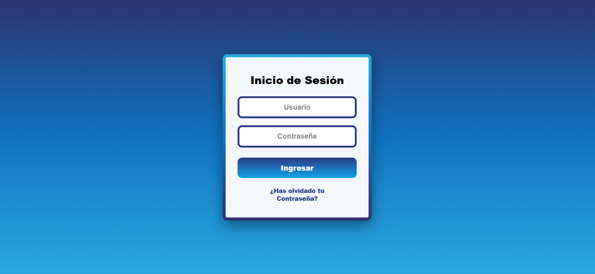

### 2. Panel Principal / Dashboard
Vista general de bienvenida al sistema con accesos rápidos a las funciones administrativas principales.
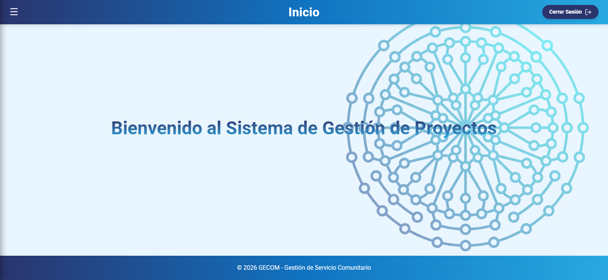

### 3. Menú Lateral de Navegación
Entorno de navegación centralizado y dinámico con acceso rápido a todos los submódulos de gestión.
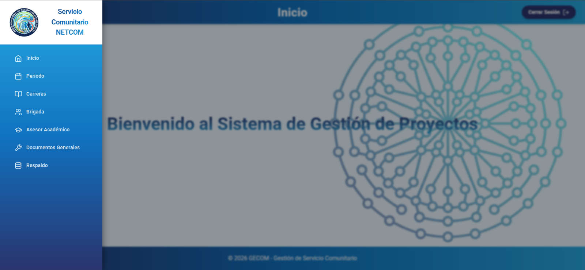

### 4. Gestión de Periodos Académicos
Configuración y delimitación formal de lapsos lectivos bajo los cuales se agrupan las brigadas y proyectos.
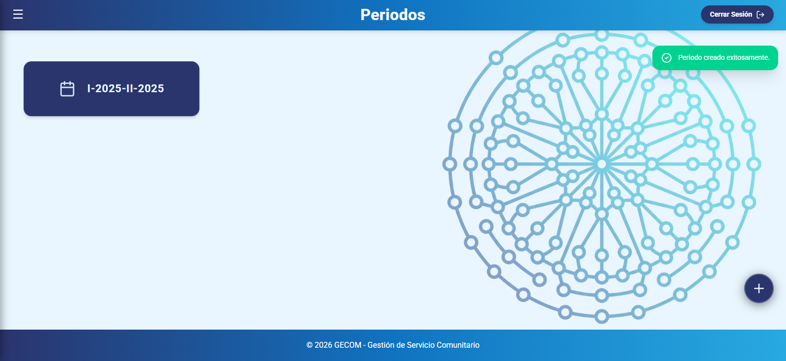

### 5. Módulo de Carreras
Clasificación jerárquica de especialidades y programas académicos para segmentar a los estudiantes pertenecientes a cada brigada.
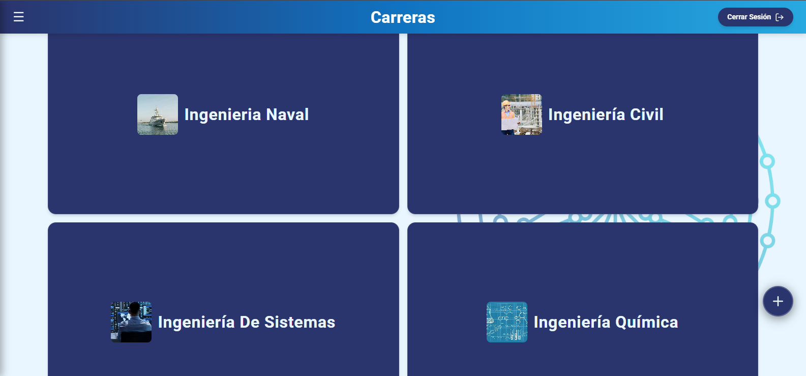

### 6. Registro y Filtro de Asesores Académicos
Panel de control de la plantilla docente con búsqueda en tiempo real e historial operativo de tutorías.
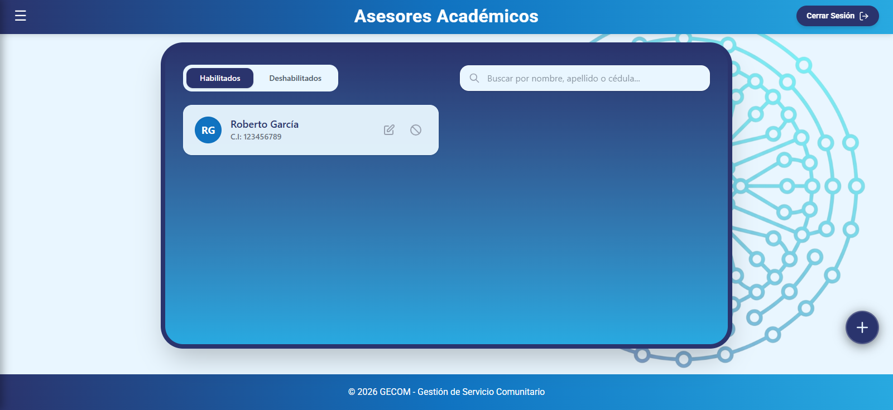

### 7. Vista General de Brigadas
Visualización unificada y búsqueda avanzada de grupos de trabajo constituidos en el periodo académico activo.
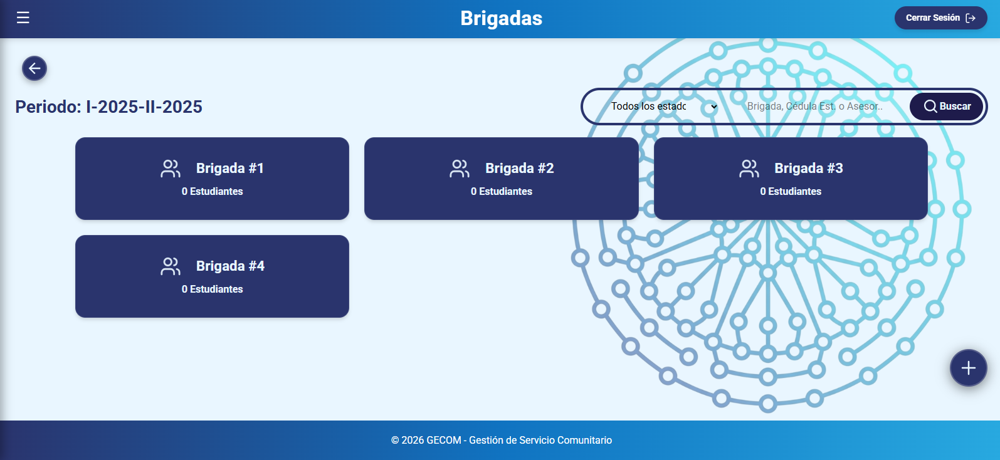

### 8. Detalle de Brigada y Asignación de Proyecto
Control integral donde convergen el asesor comunitario, el asesor académico, la información metodológica del proyecto y los estudiantes integrantes.
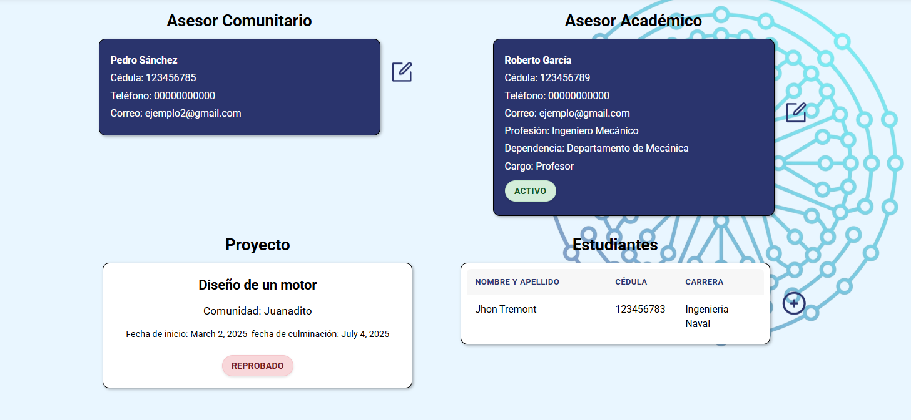

### 9. Historial y Expediente Digital del Estudiante
Gestión individualizada de la trayectoria del servidor comunitario y control de soportes digitales obligatorios.
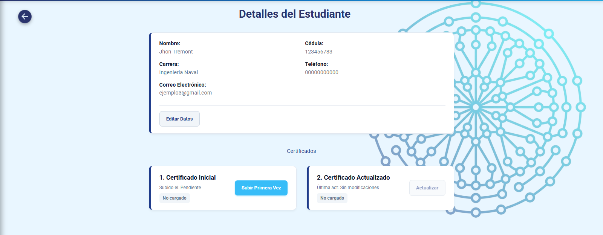

### 10. Módulo de Documentos Generales
Repositorio centralizado de plantillas, reglamentos, formatos institucionales y borradores de uso común.
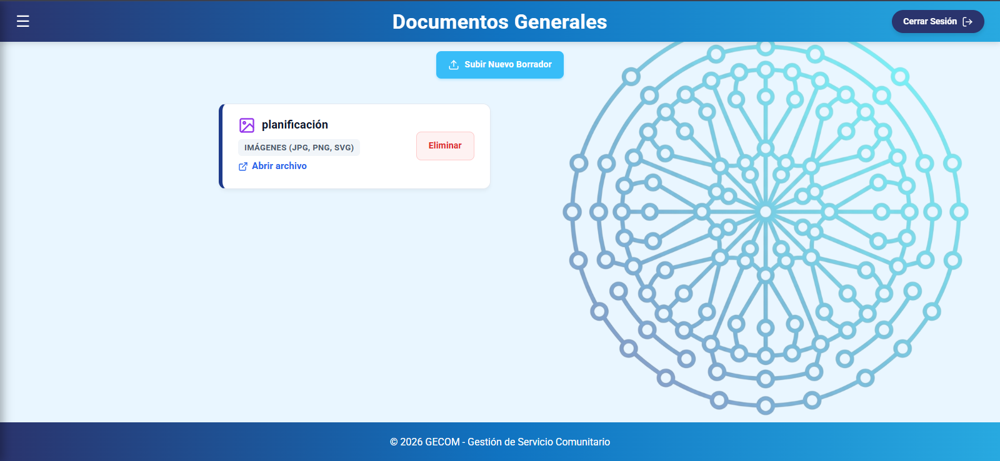

### 11. Centro de Respaldo y Sincronización en la Nube
Panel de gestión de la base de datos para generar respaldos de seguridad y ejecutar restauraciones sincronizadas con Google Drive.
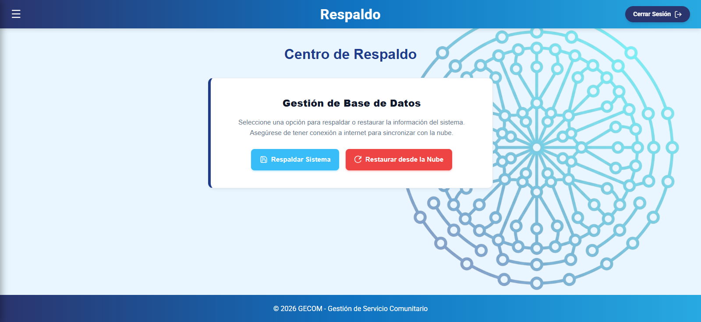

---

## 🚀 Instalación y Puesta en Marcha

El sistema está configurado para ejecutarse localmente con un motor de base de datos relacional liviano.

### Requisitos Previos
* **Python 3.14+** instalado. Se verifica con el comando:
    ```bash
    python --version
    ```
* **SQLite** integrado y operativo.
* **Git** instalado.

---

## 📄 Licencia

Todos los derechos reservados.